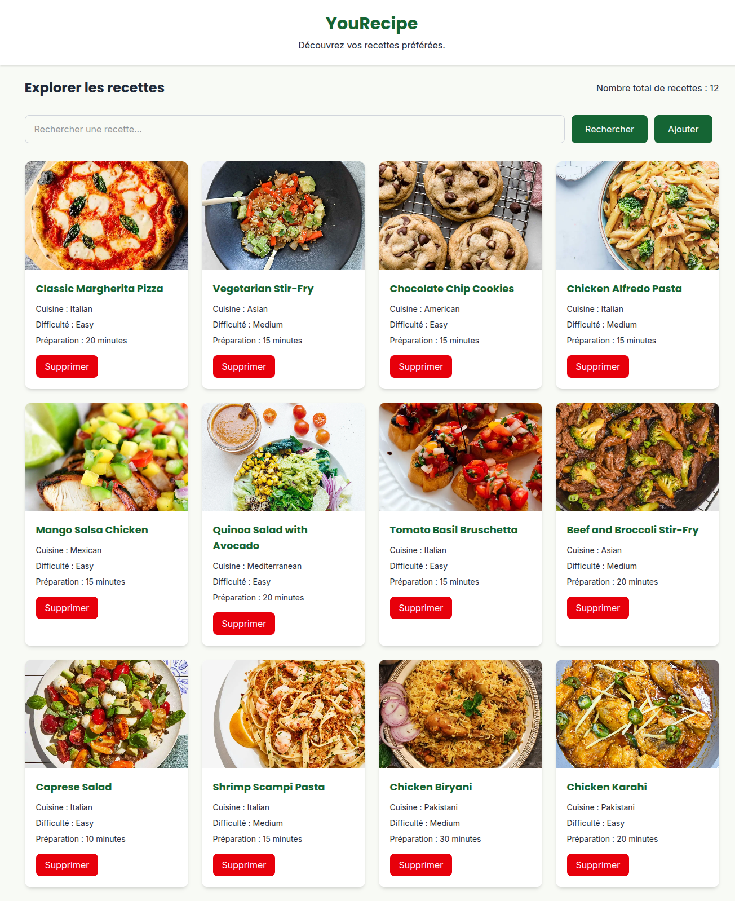
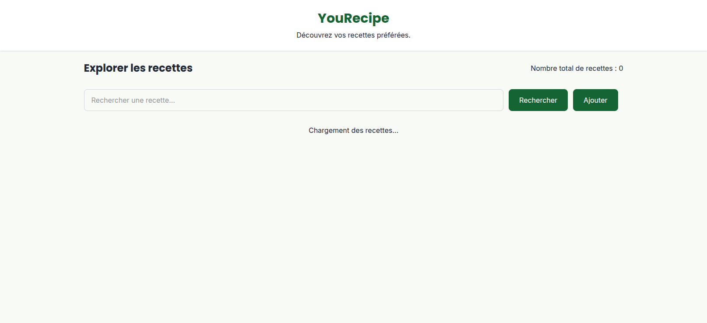
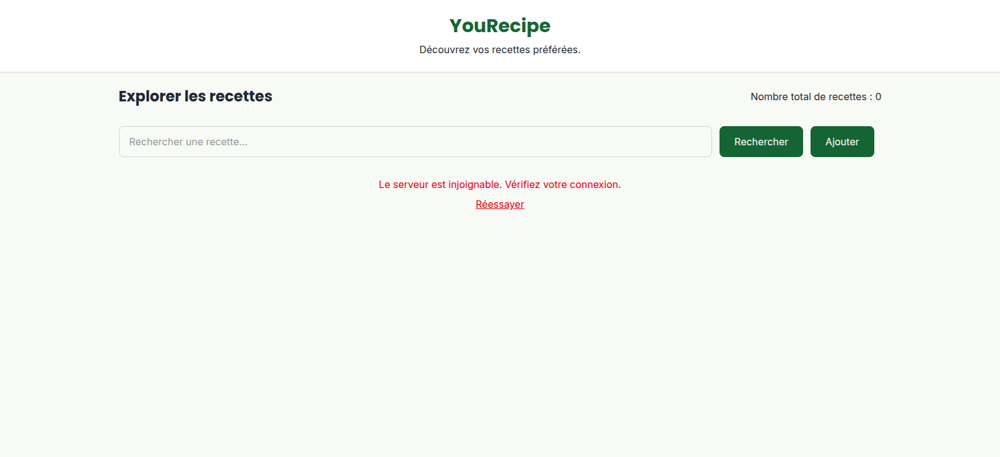
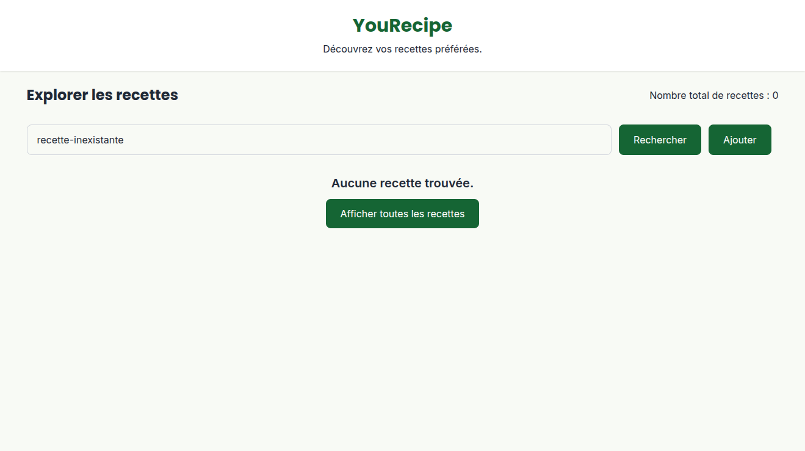

# YouRecipe

Application HTML, Tailwind CSS et JavaScript permettant de consulter, rechercher,
ajouter et supprimer des recettes avec l'API publique DummyJSON.

## Structure

- `src/api.js` : instance Axios unique et appels API.
- `src/validation.js` : validation du formulaire d'ajout.
- `src/main.js` : gestion des événements, affichage et mises à jour de la page.
- `src/style.css` : configuration Tailwind CSS.
- `index.html` : structure de l'interface.

## Requêtes

| Méthode | URL | Données envoyées | Réponse utilisée |
|---|---|---|---|
| GET | `/recipes?limit=12` | Aucun | Liste des 12 recettes |
| GET | `/recipes/search?q=mot-clé` | Paramètre `q` | Recettes correspondant à la recherche |
| POST | `/recipes/add` | `{ name, cuisine, difficulty, prepTimeMinutes }` | Nouvelle recette retournée |
| DELETE | `/recipes/{id}` | Identifiant dans l'URL | Confirmation de suppression |

Toutes les requêtes passent par une instance Axios créée avec `axios.create`,
une URL de base et un timeout.

## Scénarios de test manuels

1. Ouvrir l'application : 12 recettes doivent apparaître avec le nombre affiché.
2. Rechercher « pizza » : les résultats de l'API doivent apparaître.
3. Rechercher un mot inexistant : le message « Aucune recette trouvée » apparaît.
4. Cliquer sur « Afficher toutes les recettes » : la liste complète revient.
5. Ajouter une recette avec un nom trop court : aucun POST n'est envoyé.
6. Ajouter une recette valide : une seule carte apparaît en premier.
7. Soumettre pendant l'envoi : le bouton est désactivé.
8. Supprimer une recette : confirmer ou annuler la suppression.
9. Après confirmation : la carte disparaît et un message de succès apparaît.
10. Déconnecter le réseau : un message « serveur injoignable » apparaît.

## Captures

## Limite de l'API

DummyJSON est une API de démonstration. Les ajouts et suppressions retournent une
réponse semblable à celle d'un vrai serveur, mais ne sont pas enregistrés.
Après un rechargement de la page, la liste originale revient.
